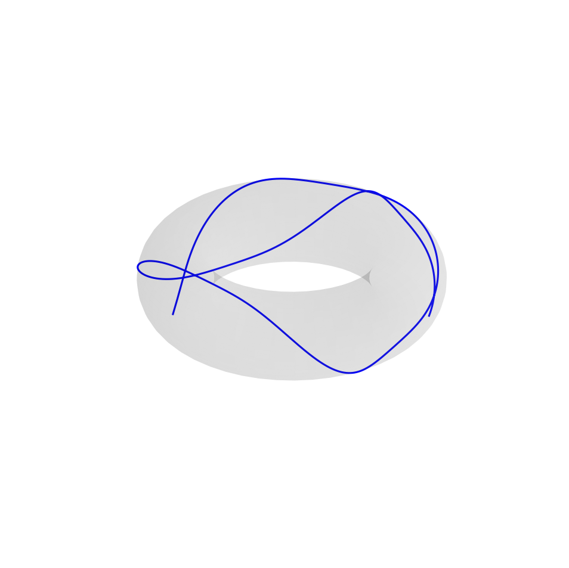

# Geodesic Surfaces

Чисельне моделювання геодезичних ліній на сфері та торі методом Рунге-Кутта 4-го порядку (RK4).

## Залежності
Для запуску скрипта візуалізації необхідні бібліотеки Python:
```bash
pip install numpy pandas matplotlib
```

## Структура репозиторію
* `main.cpp` 
* `plot_results.py`
* `figures/`

## Тест точності (нахилене коло сфери, T = 2π)
* N = 60 кроків: похибка = 1.002 × 10⁻⁵
* N = 600 кроків: похибка = 1.047 × 10⁻⁹

## Результати візуалізації

| Геодезичні на сфері | Геодезичні на торі |
| :---: | :---: |
|  |  |

## Запуск
```bash
g++ -O3 main.cpp -o geodesics && ./geodesics
python plot_results.py
```

